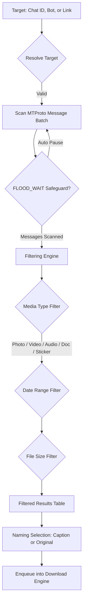

TelegramDL's **Historical Scanner** allows you to inspect the past message history of any chat, supergroup, channel, or bot you have access to, enabling you to find and download media content posted in the past.

---

## How Does the Historical Scanner Work?

The scanner engine (`pkg/scanner/scanner.go`) connects directly to Telegram's MTProto API to sequentially parse messages in the targeted chat:

### Rate Limiting & FLOOD_WAIT Protection
Telegram enforces strict limits on mass history requests. TelegramDL's scanner automatically applies calculated intelligent pauses between message inspection batches, safeguarding your account against temporary rate limits.

---

## Target Identification

In the **"Chat ID, Bot Username or Link"** field, you can enter any valid source:

| Target Type | Example | Description |
| :--- | :--- | :--- |
| **Supergroup/Channel Numeric ID** | `-1001234567890` | Private or public channel or group by ID. |
| **Username (@Username)** | `@bot_name` or `@channel_name` | Public bots, channels, or chats using their alias. |
| **Direct Telegram Link** | `https://t.me/c/123456789/500` | Link to a specific message or channel. |

---

## Advanced Search Filters

You can refine results using combined filters that process instantly:

### 1. Default Date Range & Customization
- **Default Range (3 Months)**: When opening the scanner, date fields default to a **3-month range** (*End Date* is set to today and *Start Date* is set to 3 months ago). This prevents unintended mass scans of entire chat histories and helps avoid `FLOOD_WAIT` rate limits.
- **Flexible Customization**: You can freely adjust the *Start Date* and *End Date* at any time to match the specific period you wish to inspect.
- **Smart Date-Range Caching**: The scanner engine caches scanned messages per chat. When extending the date range (e.g., to scan a 4th month prior), the system calculates already cached date segments and **only fetches missing days from Telegram**. Items outside the active date range are hidden from the current view, but remain in session cache.

### 2. Media Type Filters
Check or uncheck content types to include in the results:
- **Photos**: Images and direct captures.
- **Videos**: Videos, clips, and movies.
- **Audios**: Songs, voice notes, and audio tracks.
- **Documents**: Compressed archives (`.zip`, `.rar`, `.7z`), PDFs, APKs, etc.
- **Stickers**: Static and animated stickers.

### 3. File Size Filters
- **Min Size** and **Max Size**: Define file size thresholds with unit selectors (`B`, `KB`, `MB`, `GB`).
- *Note*: Leaving size fields blank keeps the filter open to all file sizes.

### Instant Client-side Reactivity
When modifying date, media type, or size filters after executing a scan, table results update instantly in real time without triggering additional network calls to the server.

---

## Dynamic Column Sorting

The results table allows sorting elements by clicking on column headers:

- **Default**: Displays newest messages first (date descending order).
- **Media Type**: Clicking the *Type* header sorts items according to the hierarchy: **Audio → Documents → Photos → Stickers → Videos** (and reversed when clicked again).
- **File Name**: Alphabetical sorting (A-Z / Z-A).
- **Date**: Toggles between newest first and oldest first.
- **File Size**: Sorts by file size (largest to smallest / smallest to largest).

---

## File Naming Selection & Customization

TelegramDL lets you customize naming rules before sending items to the download queue:

### Per-Item Selection
In the **Name** column of the results table, each row features a setting button that opens available naming options:
- **Caption**: Uses the message caption text as the filename.
- **Original**: Applies the original filename assigned when uploaded to Telegram.

### Bulk Name Changing
The **"Name"** button in the top toolbar of the results table allows batch renaming:
- **Use Caption**: Applies captions to all visible items in the table that have caption text available.
- **Use Original**: Applies original filenames to all items in the table.

---

## Download Actions & Pagination

- **Multi-Selection**: Select items individually using checkboxes or click **"Select All" / "Deselect All"**.
- **Download Selected**: Enqueues only checked items into the download queue.
- **Download All**: Enqueues all filtered items displayed on screen.
- **Pagination**: Organize result views in pages of **10, 25, 50, or 100** items per page for smooth navigation.
