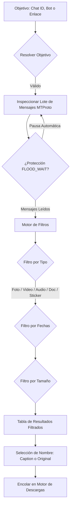

El **Escáner Histórico** de TelegramDL permite inspeccionar el historial de cualquier chat, supergrupo, canal o bot al que tengas acceso para encontrar y descargar contenido multimedia antiguo publicado en el pasado.

---

## ¿Cómo Funciona el Escáner Histórico?

El motor del escáner (`pkg/scanner/scanner.go`) se conecta directamente a la API MTProto de Telegram para recorrer secuencialmente los mensajes del chat objetivo:

### Protección contra Límites de Velocidad (FLOOD_WAIT)
Telegram impone restricciones estrictas cuando se realizan consultas masivas al historial. El escáner de TelegramDL aplica pausas inteligentes calculadas automáticamente entre cada bloque de mensajes inspeccionados, protegiendo tu cuenta contra bloqueos temporales.

---

## Identificación del Objetivo (Target)

En el campo **"ID de Chat, Bot o Enlace"** puedes introducir cualquier origen válido:

| Tipo de Objetivo | Ejemplo | Descripción |
| :--- | :--- | :--- |
| **ID Numérico de Supergrupo/Canal** | `-1001234567890` | Canal o grupo privado o público por su ID. |
| **Nombre de Usuario (@Username)** | `@nombre_bot` o `@nombre_canal` | Bots, canales o chats públicos usando su alias. |
| **Enlace Directo de Telegram** | `https://t.me/c/123456789/500` | Enlace a un mensaje específico o canal. |

---

## Filtros Avanzados de Búsqueda

Puedes afinar los resultados con filtros combinados que se procesan al instante:

### 1. Rango de Fechas por Defecto y Personalización
- **Rango por Defecto (3 Meses)**: Al abrir el escáner, las fechas se inicializan automáticamente con un rango de **3 meses** (la fecha *Hasta* se fija en el día actual y *Desde* en 3 meses hacia el pasado). Esto previene búsquedas involuntarias del chat completo y evita posibles bloqueos por `FLOOD_WAIT`.
- **Personalización Libre**: Puedes modificar las fechas *Desde* y *Hasta* en cualquier momento para ajustar el rango de búsqueda según tus necesidades.
- **Caché Inteligente por Rangos**: El motor del escáner almacena en caché los mensajes ya escaneados por chat. Si amplías el rango (por ejemplo, para inspeccionar un 4.º mes atrás), el sistema únicamente solicita a Telegram los días faltantes. Los elementos fuera del rango seleccionado actualmente se ocultan de la vista, pero se conservan en la caché de la sesión.

### 2. Filtros por Tipo de Archivo
Marca o desmarca los tipos de contenido que deseas incluir en los resultados:
- **Fotos**: Imágenes y capturas directas.
- **Vídeos**: Vídeos, clips y películas.
- **Audios**: Canciones, notas de voz y pistas musicales.
- **Documentos**: Archivos comprimidos (`.zip`, `.rar`, `.7z`), PDFs, APKs, etc.
- **Stickers**: Stickers estáticos y animados.

### 3. Filtros por Tamaño de Archivo
- **Tamaño Mínimo** y **Tamaño Máximo**: Define límites de tamaño con selector de unidad (`B`, `KB`, `MB`, `GB`).
- *Nota*: Si se dejan en blanco, el filtro permanece abierto y muestra archivos de cualquier tamaño.

### Reactividad Instantánea en Cliente
Al cambiar las opciones de fecha, tipo o tamaño tras realizar una búsqueda, los resultados de la tabla se filtran en tiempo real sin requerir una nueva petición al servidor.

---

## Ordenación Dinámica de Resultados

La tabla de resultados permite ordenar los elementos haciendo clic directamente sobre los encabezados de las columnas:

- **Por Defecto**: Muestra los mensajes más recientes primero (orden por fecha descendente).
- **Tipo de Archivo**: Al hacer clic en el encabezado *Tipo*, ordena los elementos según la jerarquía: **Audio → Documentos → Fotos → Stickers → Videos** (y en orden inverso al pulsar de nuevo).
- **Nombre de Archivo**: Ordenación alfabética ascendente (A-Z) y descendente (Z-A).
- **Fecha**: Alterna entre mensajes más recientes primero y más antiguos primero.
- **Tamaño**: Ordena de mayor a menor tamaño o de menor a mayor.

---

## Selección y Personalización de Nombres de Archivo

TelegramDL te permite elegir la regla de nombre de los archivos antes de enviarlos a la cola de descargas:

### Selección Individual por Archivo
En la columna **Nombre** de la tabla de resultados, cada elemento cuenta con un botón de configuración que despliega las opciones disponibles:
- **Caption (Leyenda)**: Usa el texto o pie de foto del mensaje como nombre de archivo.
- **Original**: Aplica el nombre de archivo original asignado al subirlo a Telegram.

### Cambiar Nombre Masivo
En la barra superior de herramientas de la tabla se encuentra el botón **"Nombre"**:
- **Usar Caption**: Asigna la leyenda a todos los archivos visibles en la tabla que tengan pie de foto disponible.
- **Usar Original**: Aplica el nombre original a todos los archivos de la tabla.

---

## Acciones de Descargar y Paginación

- **Selección Múltiple**: Puedes marcar casillas individuales o usar el botón **"Seleccionar todos" / "Deseleccionar todos"**.
- **Descargar seleccionados**: Encola únicamente los elementos marcados.
- **Descargar todos**: Encola la totalidad de los archivos filtrados en pantalla.
- **Paginación**: Permite organizar la vista de resultados en páginas de **10, 25, 50 o 100** elementos por página para una navegación fluida.
